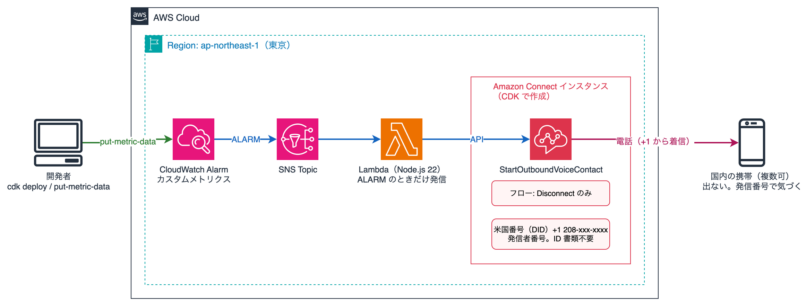

# cloudwatch-alarm-amazon-connect-call

CloudWatch Alarm が ALARM になったとき、Amazon Connect から携帯電話に発信して知らせるサンプルコードです。電話には出ない運用を想定しています。あらかじめ発信番号を伝えておき、その番号から着信があれば「アラームが発生した」と認識するだけです。

[English](README.md)

## 仕様

- CloudWatch Alarm → SNS → Lambda → Amazon Connect `StartOutboundVoiceContact` → 携帯に着信
- 着信先は複数指定できる（全員に同時に発信）
- 発信元は米国の電話番号（取得に ID 書類が不要）。Connect インスタンスは東京リージョンに作成する
- フローは切断のみ。読み上げや応答の受付は行わない
- ALARM への遷移時だけ発信する。OK への復帰では発信しない
- Connect インスタンス・電話番号・フローを含めて CDK で作成するため、`cdk destroy` で電話番号の日額課金も止まる

## 構成



| 構成要素 | 説明 |
|---|---|
| Amazon Connect インスタンス | CONNECT_MANAGED、着信無効・発信有効 |
| 電話番号 | 米国 DID。発信者番号として使う |
| フロー | DisconnectParticipant のみ |
| SNS トピック + Lambda（Node.js 22） | Alarm の通知を受け、着信先ごとに StartOutboundVoiceContact を呼ぶ |
| CloudWatch Alarm（検証用） | カスタムメトリクス `CloudWatchAlarmConnectCall/Trigger` が 1 以上で ALARM |

## ディレクトリ構成

```
.
├── cdk/
│   ├── bin/app.ts
│   ├── lib/stack.ts        # 全リソース
│   ├── lambda/index.ts     # 発信処理
│   └── cdk.json            # context.destinations に着信先を書く
├── scripts/
│   ├── alarm.sh            # 検証用メトリクスを送って ALARM にする
│   ├── status.sh           # Alarm の状態と Lambda のログを表示する
│   └── contacts.sh         # 直近の発信を一覧し、課金対象の秒数（TOTAL と TALK）を表示する
└── docs/architecture.png
```

## 前提条件

- AWS アカウントと認証情報（リージョン: ap-northeast-1）
- Node.js 22 以上、pnpm
- AWS CLI v2
- 対象アカウント・リージョンで CDK bootstrap 済みであること（未実施なら `pnpm cdk bootstrap`）

使用したバージョン: aws-cdk-lib 2.273.0、aws-cdk 2.1147.0、TypeScript 7.0.2、Node.js 22.23.4、pnpm 10.24.0

## 費用

- 電話番号（米国 DID）: 保持している間、日額が発生する（料金ページを参照）
- 発信: Connect の音声利用料（分単位）と日本向けの通話料
- Connect インスタンス自体に固定費はない
- 検証が終わったら必ず `cdk destroy` で電話番号とインスタンスを削除してください

## 構築手順

### 1. クローンとインストール

```bash
git clone https://github.com/furuya02/cloudwatch-alarm-amazon-connect-call.git
cd cloudwatch-alarm-amazon-connect-call/cdk
pnpm install
```

### 2. 着信先の設定

`cdk/cdk.json` の `context.destinations` に E.164 形式（+81 で始め、先頭の 0 を落とす）で着信先を書きます。

```json
"context": {
  "destinations": ["+8190XXXXXXXX", "+8180YYYYYYYY"]
}
```

`-c destinations=+8190XXXXXXXX,+8180YYYYYYYY` で上書きもできます。

### 3. デプロイ

```bash
pnpm cdk deploy
```

出力の `SourcePhoneNumber` が発信番号です。この番号を着信先の利用者に伝えておきます。

フローの内容は context の `flow` で切り替えられます（省略時は `disconnect`）。

| flow | フローの内容 | 用途 |
|---|---|---|
| disconnect | 切断だけ | 電話に出ない運用 |
| probe | 約 45 秒の読み上げの後に切断 | 誰が応答しているかの切り分け |
| message | アラート名と状態を 3 回読み上げて切断 | 留守番電話にアラート内容を残す |

```bash
pnpm cdk deploy -c flow=message
```

留守番電話が有効な携帯では、電話に出なくても約 20 秒で留守番電話が応答して接続が成立し、1 通話あたり 1 分分の通話料がかかります。`message` は接続後 60 秒以内に収まるよう、1 回約 10 秒の読み上げを 3 回繰り返します（1 回目は留守番電話の応答メッセージに重なって録音されません）。

### 4. 日本の携帯電話へ発信できない場合

東京リージョンのインスタンスは既定で日本へ発信できますが、日本の携帯電話（+8170 / +8180 / +8190）は既定では許可されていない場合があります。Lambda のログに `DestinationNotAllowedException` が出た場合は、サポートケースでサービスクォータの引き上げを申請します。

1. Support コンソール → ケースを作成 → 「Account and billing」
2. Service: Connect (Number Management)、Category: Country Allowlisting for Outbound Calls
3. 説明に、インスタンス ARN と「Japan（携帯 +8170 / +8180 / +8190 を含む）への発信を許可してほしい」旨、用途を記載

参考: [Countries that call centers using Amazon Connect can call by default](https://docs.aws.amazon.com/connect/latest/adminguide/country-code-allow-list.html)

## 動作確認

```bash
# ALARM にする（閾値 1 以上の値を送る）
../scripts/alarm.sh

# Alarm の状態と Lambda のログ（ContactId またはエラー）
../scripts/status.sh
```

1 分ほどで Alarm が ALARM になり、着信先の携帯に発信番号から着信します。電話には出ずに切ってください。

OK に戻すには、メトリクスの送信を止めて 1〜2 分待ちます（欠損データを OK 扱いにしています）。OK への復帰では発信しません。

直近の発信と、課金される秒数は `contacts.sh` で確認できます。Connect の音声利用料は秒単位で、呼び出し中（`RING`）も含めた `TOTAL` が対象です。通話料は接続後の `TALK` を 1 分単位で切り上げるので、`TALK` が 60 秒を超えると 2 分分になり、目印が付きます。

```bash
../scripts/contacts.sh        # 既定は直近 7 日
../scripts/contacts.sh 30     # 日数を指定
# INITIATED            CONNECTED    DISCONNECTED   RING   TALK  TOTAL  REASON
# 2026-11-02 03:58:41 03:59:03     03:59:34         23     31     54  CONTACT_FLOW_DISCONNECT
```

着信側で国際電話の着信拒否を有効にしていると着信しません。

## 後片付け

```bash
pnpm cdk destroy
```

削除後、Amazon Connect コンソールで電話番号とインスタンスが残っていないことを確認してください。
