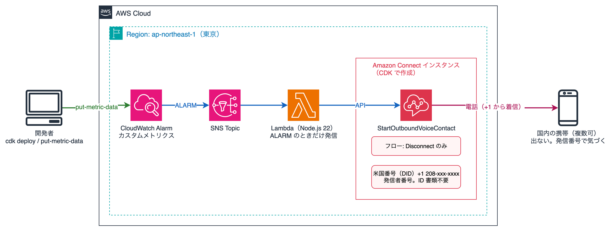

# cloudwatch-alarm-amazon-connect-call

Sample code that places a phone call from Amazon Connect to mobile phones when a CloudWatch Alarm goes into the ALARM state. The call is not meant to be answered. Recipients are told the caller ID in advance, and an incoming call from that number simply means "an alarm fired".

[日本語](README.ja.md)

## Specification

- CloudWatch Alarm → SNS → Lambda → Amazon Connect `StartOutboundVoiceContact` → call to mobile phones
- Multiple destinations are supported (all are called at the same time)
- The caller ID is a US phone number (no identity documents required). The Connect instance is created in the Tokyo region
- The flow only disconnects. No prompt is played and no input is accepted
- Calls are placed only on the transition to ALARM, not on recovery to OK
- The Connect instance, phone number and flow are all created by CDK, so `cdk destroy` also stops the daily charge for the phone number

## Architecture



| Component | Description |
|---|---|
| Amazon Connect instance | CONNECT_MANAGED, inbound disabled, outbound enabled |
| Phone number | US DID, used as the caller ID |
| Flow | DisconnectParticipant only |
| SNS topic + Lambda (Node.js 22) | Receives the alarm notification and calls StartOutboundVoiceContact per destination |
| CloudWatch Alarm (for testing) | ALARM when the custom metric `CloudWatchAlarmConnectCall/Trigger` is 1 or more |

## Directory layout

```
.
├── cdk/
│   ├── bin/app.ts
│   ├── lib/stack.ts        # all resources
│   ├── lambda/index.ts     # outbound call handler
│   └── cdk.json            # destinations go in context.destinations
├── scripts/
│   ├── alarm.sh            # send the test metric to trigger ALARM
│   ├── status.sh           # show alarm state and Lambda logs
│   └── contacts.sh         # list recent calls with the billable seconds (TOTAL and TALK)
└── docs/architecture.png
```

## Prerequisites

- AWS account and credentials (region: ap-northeast-1)
- Node.js 22+, pnpm
- AWS CLI v2
- CDK bootstrapped in the target account/region (`pnpm cdk bootstrap` if not)

Versions used: aws-cdk-lib 2.273.0, aws-cdk 2.1147.0, TypeScript 7.0.2, Node.js 22.23.4, pnpm 10.24.0

## Cost

- Phone number (US DID): charged per day while claimed (see the pricing page)
- Calls: Connect voice usage per minute plus telephony charges to Japan
- The Connect instance itself has no fixed cost
- Run `cdk destroy` when you are done so the phone number and instance are removed

## Setup

### 1. Clone and install

```bash
git clone https://github.com/furuya02/cloudwatch-alarm-amazon-connect-call.git
cd cloudwatch-alarm-amazon-connect-call/cdk
pnpm install
```

### 2. Configure destinations

Edit `context.destinations` in `cdk/cdk.json` using E.164 format (start with +81 and drop the leading 0).

```json
"context": {
  "destinations": ["+8190XXXXXXXX", "+8180YYYYYYYY"]
}
```

You can also override with `-c destinations=+8190XXXXXXXX,+8180YYYYYYYY`.

### 3. Deploy

```bash
pnpm cdk deploy
```

The `SourcePhoneNumber` output is the caller ID. Share it with the recipients beforehand.

The flow content is selected with the `flow` context value (default `disconnect`).

| flow | Flow content | Purpose |
|---|---|---|
| disconnect | Disconnect only | Do-not-answer operation |
| probe | About 45 seconds of speech, then disconnect | Find out who answers the call |
| message | Read the alarm name and state 3 times, then disconnect | Leave the alarm details on voicemail |

```bash
pnpm cdk deploy -c flow=message
```

If voicemail is enabled on the mobile phone, the carrier's voicemail answers about 20 seconds after the call is placed even when nobody picks up, so the call connects and one minute of call charges applies per call. `message` repeats a roughly 10-second sentence 3 times so that the connected time stays under 60 seconds (the first repetition overlaps the voicemail greeting and is not recorded).

### 4. If calls to Japanese mobile phones are not allowed

Instances in the Tokyo region can call Japan by default, but Japanese mobile prefixes (+8170 / +8180 / +8190) may not be allowed by default. If the Lambda log shows `DestinationNotAllowedException`, request a service quota increase through a support case.

1. Support console → Create case → "Account and billing"
2. Service: Connect (Number Management), Category: Country Allowlisting for Outbound Calls
3. In the description, include the instance ARN, that you want to call Japan including mobile prefixes +8170 / +8180 / +8190, and the use case

Reference: [Countries that call centers using Amazon Connect can call by default](https://docs.aws.amazon.com/connect/latest/adminguide/country-code-allow-list.html)

## Verification

```bash
# trigger ALARM (send a value of 1 or more)
../scripts/alarm.sh

# alarm state and Lambda logs (ContactId or error)
../scripts/status.sh
```

Within about a minute the alarm goes into ALARM and the destinations receive a call from the caller ID. Do not answer; just dismiss it.

To return to OK, stop sending the metric and wait 1–2 minutes (missing data is treated as not breaching). No call is placed on recovery.

`contacts.sh` lists recent calls with the billable seconds. Amazon Connect voice usage is billed per second on `TOTAL`, which includes the ringing time (`RING`). Telephony is billed per minute, rounded up, on the connected time `TALK`, so calls whose `TALK` exceeds 60 seconds are billed as 2 minutes and are flagged.

```bash
../scripts/contacts.sh        # last 7 days by default
../scripts/contacts.sh 30     # specify the number of days
# INITIATED            CONNECTED    DISCONNECTED   RING   TALK  TOTAL  REASON
# 2026-11-02 03:58:41 03:59:03     03:59:34         23     31     54  CONTACT_FLOW_DISCONNECT
```

Calls will not arrive if the recipient has blocked international calls on their carrier.

## Cleanup

```bash
pnpm cdk destroy
```

After deletion, confirm in the Amazon Connect console that no phone number or instance remains.
